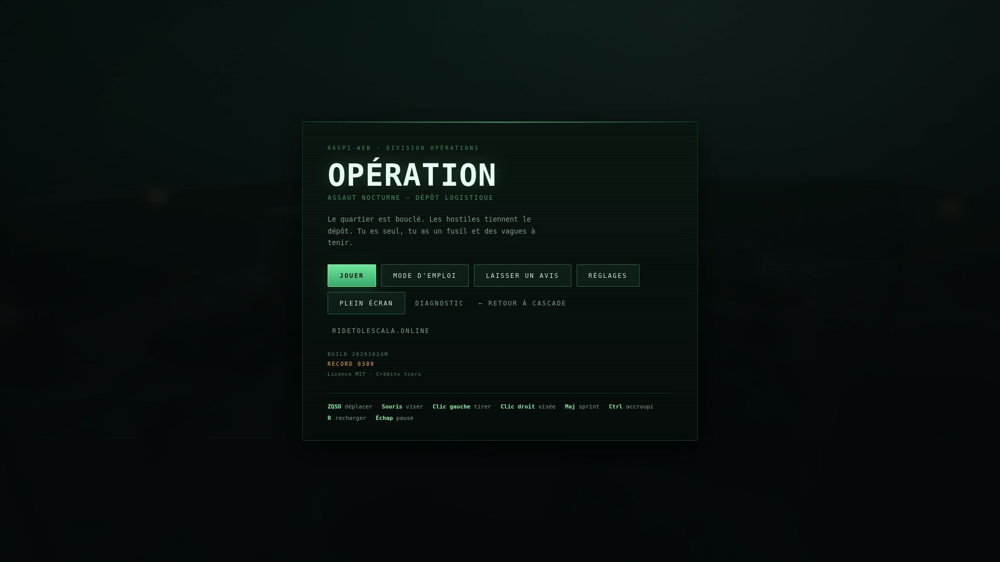
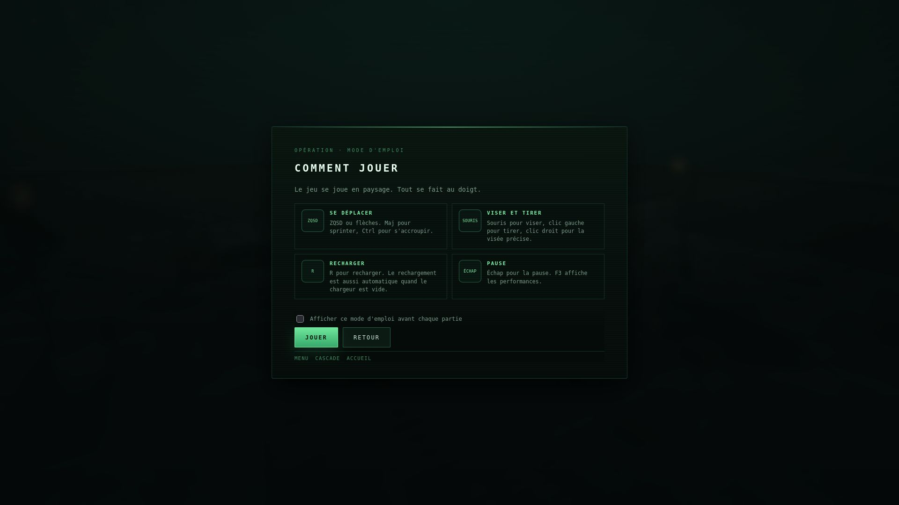
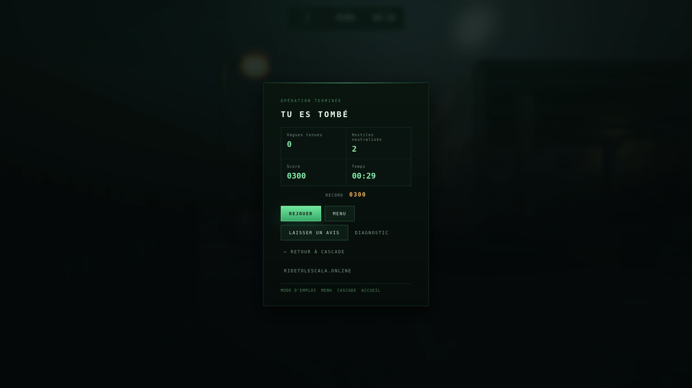
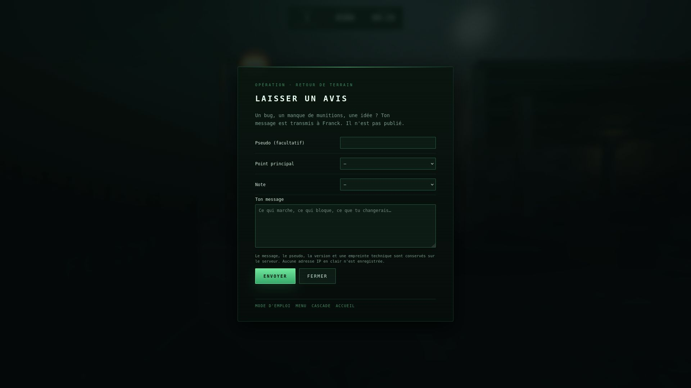
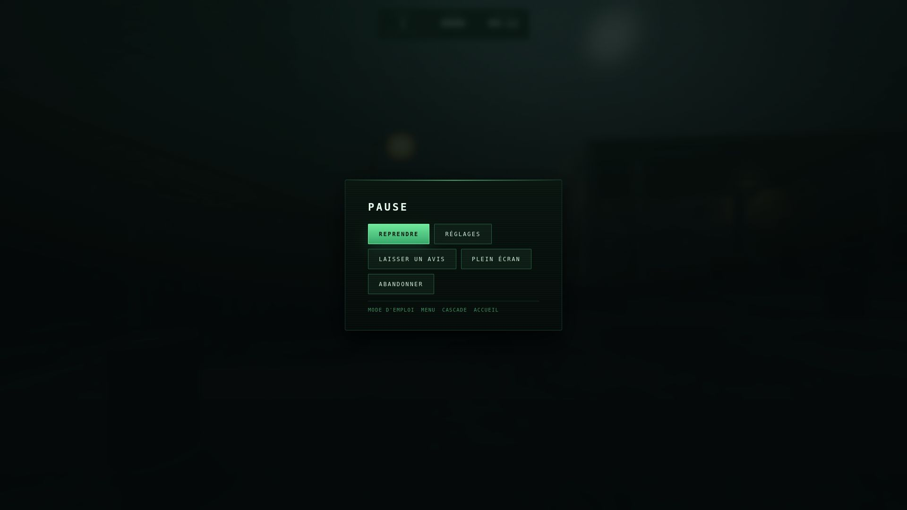
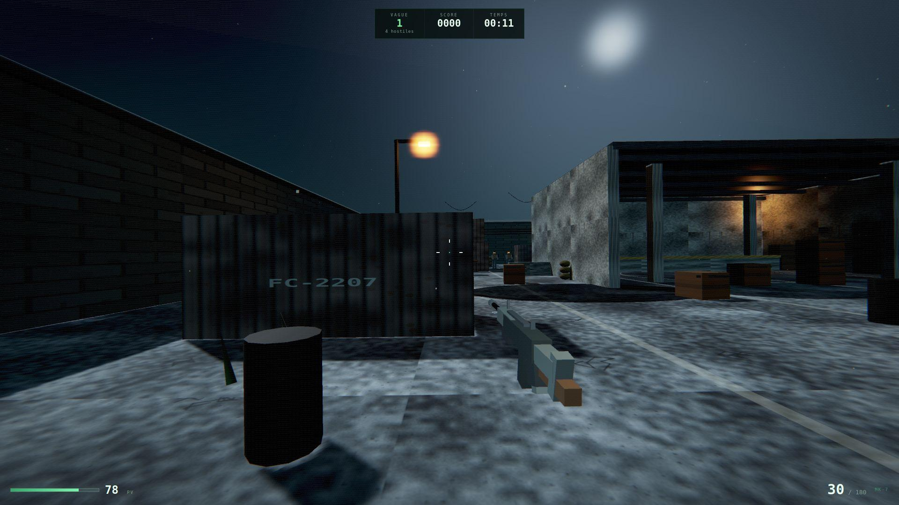

# OPÉRATION — jeu d'arcade mobile pour raspi-web

Petit jeu de tir 3D à la première personne, jouable au doigt sur téléphone.
Aucune dépendance réseau : Three.js est vendorisé, les textures sont générées au
chargement, tout le son est synthétisé.

Version mobile simplifiée : une arène, une arme, des vagues, un score et un record local.

## Captures

<p align="center">
  
  
  
  
  
  
</p>

## Contenu

```
cod/
├── index.html        page du jeu (menus, HUD, import map)
├── style.css         interface, menus, HUD, commandes tactiles
├── lib/
│   ├── three.module.js   Three.js 0.186.1 (vendorisé)
│   └── three.core.js
└── js/
    ├── config.js     réglages et équilibrage (un seul endroit à toucher)
    ├── main.js       boucle, états de jeu, HUD, menus, orientation
    ├── world.js      niveau, lumières, ciel, collisionneurs
    ├── player.js     entrées clavier/tactile, déplacement, collisions
    ├── weapon.js     arme, tir, aide à la visée, effets
    ├── enemies.js    hostiles, IA, vagues, apparitions annoncées
    ├── postfx.js     bloom, vignette, grain, aberration
    ├── textures.js   textures procédurales (canvas)
    └── audio.js      sons synthétisés (WebAudio)
```

## Commandes (téléphone / tablette)

Le jeu se joue **en paysage**.

- **Flèches** en bas à gauche : se déplacer.
- **Glisser** le pouce droit sur l'image : viser.
- **Tap court** sur la zone de visée : tirer une balle.
- **Maintenir** le doigt immobile : tir continu.
- **Bouton TIR** en bas à droite : tir continu en secours.
- **RECH.** : recharger manuellement (le rechargement est aussi automatique).
- **II** en haut à droite : pause.
- **Plein écran** : bouton dans le menu et la pause (Android ; ignoré sur iPhone).

Une aide discrète à la visée rapproche la balle d'un hostile visible. Elle se règle
dans les réglages. La qualité passe automatiquement en « Basse » au premier lancement
sur téléphone, et la résolution s'adapte si le jeu peine.

Au premier lancement, un **mode d'emploi** s'affiche avant la partie. Le bouton
**MODE D'EMPLOI** du menu permet de le revoir, et une case permet de l'afficher
avant chaque partie.

## Commandes (clavier / souris)

| Touche | Action |
|---|---|
| ZQSD / flèches | se déplacer |
| Souris | viser |
| Clic gauche | tirer |
| Clic droit | viser (ADS) |
| Maj | sprint |
| Ctrl | accroupi |
| Espace | sauter |
| R | recharger |
| M | couper/rétablir le son |
| Échap | pause |
| F3 | compteur de performance |

Réglages (sensibilités, volume, qualité, axe Y, aide à la visée, tactile) conservés
dans `localStorage`, ainsi que le record.

## Avis des visiteurs

Le bouton **LAISSER UN AVIS** est disponible dans le menu, la pause et l'écran de fin.
Le message est envoyé par `commentaire.php` et stocké **hors de la racine web**, dans
`/var/www/default/data/commentaires-operation.jsonl` (JSONL, une ligne par message).
Les messages ne sont pas publiés. Une empreinte d'IP tronquée sert uniquement à
limiter les envois ; l'adresse en clair n'est pas conservée.

Pour les lire sur `raspi-web` :

```bash
sudo tail -n 20 /var/www/default/data/commentaires-operation.jsonl
```

## Tester en local

```bash
cd jeu-operation
python3 -m http.server 8123
# ouvrir http://127.0.0.1:8123/
```

Un serveur est nécessaire : les modules ES ne se chargent pas en `file://`.
Ajouter `?debug=1` pour afficher le diagnostic.

## Staging sur raspi-web

Le staging est servi par un petit serveur Python sur l'interface Tailscale :

```bash
# depuis le poste de travail
rsync -a --delete --exclude '.git' ./ franck@raspi-web:~/jeu-staging/cod/

# sur raspi-web
systemctl --user restart jeu-staging.service   # ou systemd-run, voir plus bas
```

Adresse téléphone (Tailscale actif) : `http://100.87.78.97:8123/cod/`

## Déployer en production

Sauvegarder puis copier dans la racine web :

```bash
ssh franck@raspi-web
sudo cp -a /var/www/default/public/jeu/cod \
          /var/www/default/public/jeu/cod.bak-$(date +%F-%H%M)
sudo rsync -a --delete --exclude '.git' ~/jeu-staging/cod/ \
          /var/www/default/public/jeu/cod/
sudo chown -R root:www-data /var/www/default/public/jeu/cod
```

Ouvrir ensuite `https://franck.estingoy.fr/jeu/cod/` (ou `https://raspi-web.local/jeu/cod/`).

### Revenir en arrière

```bash
sudo rm -rf /var/www/default/public/jeu/cod
sudo mv /var/www/default/public/jeu/cod.bak-AAAAMMJJ-HHMM \
        /var/www/default/public/jeu/cod
```

## Ce que c'est, ce que ce n'est pas

C'est un jeu d'arcade **soigné et jouable au téléphone**, pas un AAA : pas de campagne,
pas de multijoueur, pas de compte, pas de publicité. Le niveau tient sur une arène,
l'IA se résume à patrouille → détection → tir → couverture, avec une ligne de vue
réellement vérifiée.

Ce qui est en place : éclairage dynamique, post-traitement, textures procédurales,
arme avec recul et rechargement, impacts, douilles, traçantes, son synthétisé,
vagues, apparitions annoncées, headshots, score, record, HUD complet, commandes
tactiles et clavier, réglages persistants.

Le modèle d'arme est rendu dans une couche séparée : il ne traverse plus
visuellement les murs. Les balles sont arrêtées par le décor, même à bout
portant. Les **lampadaires sont destructibles** : chaque tir qui touche un lampadaire
réduit sa lumière de 5 % ; après vingt tirs, elle grésille puis s'éteint, avec son
halo. Ils se rallument au début d'une nouvelle partie.

Les apparitions sont vérifiées pour ne jamais placer un hostile dans un mur ou
hors de l'arène. Si un hostile s'y retrouve malgré tout, il est replacé sur un
point libre. Quand il ne reste qu'un seul hostile, un indicateur rouge indique
sa direction et sa distance.

## Compatibilité

- WebGL 2 obligatoire ; sans lui, une page « WEBGL 2 REQUIS » s'affiche proprement.
- Android Chrome et iPhone Safari : mode tactile automatique, audio après le premier
  appui, adaptation à la résolution, message clair en portrait.
- Le plein écran est redemandé automatiquement au premier contact s'il a été perdu,
  et le démarrage laisse un court délai au verrouillage d'orientation avant toute
  mise en pause.
- Un ordinateur portable tactile reste en mode souris/clavier tant que l'utilisateur
  ne touche pas l'écran ; le mode tactile peut être forcé dans les réglages.

## Notes techniques

- Le Raspberry Pi ne fait que servir les fichiers ; le rendu se fait sur l'appareil.
- Le rendu passe par une cible de rendu puis une composition maison
  (`renderer.toneMapping = NoToneMapping`, ACES dans `postfx.js`).
- En qualité basse, la cible est en 8 bits et le matériau de composition est mis en
  cache (plus d'allocation par image).
- Résolution adaptative : si le téléphone descend sous ~27 fps, l'échelle de rendu
  baisse progressivement jusqu'à 60 %.


## Licence

Le code du jeu est distribué sous licence **MIT** — voir `LICENSE`.

Three.js est distribué sous licence MIT — voir `THIRD-PARTY-NOTICES.txt`.
© 2026 Franck Estingoy.

Le nom « OPÉRATION », l'identité visuelle et les messages laissés par les
visiteurs ne sont pas couverts par la licence du code.
